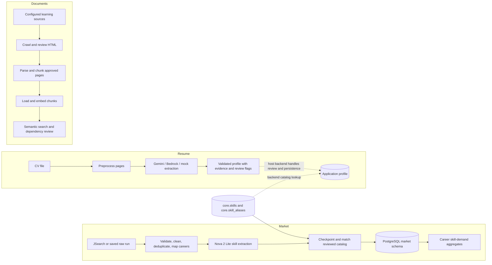

# Glow Job Data Pipeline

Data processing components for Glow Job. This repository collects and analyzes job postings in Thailand, extracts structured information from CVs, and prepares reviewed learning content for search. It is designed as a data-pipeline sub-repository; application APIs, user workflows, and product persistence are owned by the host Glow Job backend.

## Project status

| Domain | Current capabilities | Boundary |
|---|---|---|
| Market | JSearch collection and replay, validation, cleaning, deduplication, company/career normalization, evidence-backed skill extraction, catalog matching, PostgreSQL loading, career skill-demand aggregation, and a resumable scheduled-runner entry point. | Live runs use JSearch and Amazon Bedrock Nova 2 Lite. New catalog entries require a separate review and apply workflow. |
| Resume | PDF/image preprocessing, structured CV extraction through Gemini, Bedrock Converse, or a mock provider, schema validation, evidence and review metadata, and derived profile facts. | The host backend owns uploads, job status, catalog lookup, user confirmation, and saving confirmed profiles. |
| Documents | Bounded HTML crawling, human review, approved-page parsing, heading-aware chunking, skill mapping, PostgreSQL/pgvector loading, Gemini/Nova embeddings, semantic search, and document-backed skill-dependency proposal/review/apply tools. | Search is a retrieval prototype. A user-facing RAG answer flow, personalized curriculum, and roadmap integration belong to later application work. |

The Market and Resume domains can use the shared canonical skill catalog, but they process different data. Market writes postings and matched job skills to `market.*`; the reusable Resume package does not write profiles or add skills to the catalog. Document content and vectors are stored under `knowledge.*`.

## Architecture



Shared code under `src/shared/` provides provider clients, database setup, utilities, and deterministic skill-name normalization. Domain prompts, schemas, and business rules stay in their owning packages.

## Requirements and local setup

- Python 3.10 or newer
- PostgreSQL 16 with the `pgvector` extension for database-backed Market and Documents workflows
- Docker Compose is provided for a local PostgreSQL instance
- API/AWS credentials are needed only for workflows that call the corresponding provider

### Windows PowerShell

```powershell
py -m venv .venv
.\.venv\Scripts\Activate.ps1
python -m pip install -r requirements.txt
Copy-Item .env.example .env
```

Edit `.env` for the integrations you plan to use. `.env` contains secrets and is excluded from Git. Configure career searches in `config/careers.yaml`, market search and validation settings in `config/pipeline.yaml`, confirmed employer aliases in `config/company_aliases.yaml`, and learning sources in `config/document_sources.yaml`.

### Environment variables

| Variable | Used for |
|---|---|
| `JSEARCH_API_KEY` or `JSEARCH_SECRET_ID` | Live Market collection through JSearch. `JSEARCH_SECRET_ID` reads the key from AWS Secrets Manager. |
| `DB_HOST`, `DB_PORT`, `DB_NAME`, `DB_USER`, `DB_PASSWORD` | PostgreSQL connection. Defaults in `.env.example` are set up for the documented development environment; adjust them when using local Compose or another database. |
| `RAW_S3_BUCKET`, `RAW_S3_PREFIX`, `AWS_DEFAULT_REGION` | Optional S3 copies of Market raw responses and scheduled-run settings. The scheduled runner defaults to S3; pass `--raw-storage local` for local-only operation. S3 access uses the standard AWS credential chain. |
| `AWS_BEARER_TOKEN_BEDROCK` or AWS credentials | Market skill extraction, Nova document embeddings, and optional Bedrock Resume extraction. |
| `BEDROCK_EXTRACTION_MODEL` | Optional Bedrock model ID for Resume extraction; defaults to `us.amazon.nova-2-lite-v1:0`. |
| `RESUME_EXTRACTOR` | Resume provider: `mock` (default), `gemini`, or `bedrock_converse`. |
| `GEMINI_API_KEY` | Gemini Resume extraction and Gemini document embeddings. |
| `LOG_LEVEL` | Market logging level. |

The exact optional Resume provider settings, page limits, and timeouts are defined in [`src/resume/config.py`](src/resume/config.py). Never commit credentials or real CV files.

## Database

Start the local PostgreSQL service (set `DB_PASSWORD` in `.env` first), then apply the ordered migrations:

```powershell
docker compose up -d postgres
python -m scripts.database.migrate
```

The database image includes pgvector. The migration runner applies this repository's `migrations/versions/` files in order and records successful migrations in `system.schema_migrations`. The host repository may provide additional migration files; see [`migrations/README.md`](migrations/README.md) and [database schema overview](docs/database/database-schema-overview.md) for migration history and schema ownership.

Initialize Market career reference data before loading postings:

```powershell
python -m scripts.market.seed_reference_data
```

## Common workflows

Run commands from the repository root with `python -m`.

### Market collection and replay

Run the full pipeline from a saved raw run:

```powershell
python -m scripts.market.run_pipeline --replay-run-id <run-id> --start-date 2026-10-01 --end-date 2026-10-25 --date-basis first_seen_at
```

Or start a live run (uses JSearch, Bedrock, and the configured database):

```powershell
python -m scripts.market.run_pipeline --live --start-date 2026-10-01 --end-date 2026-10-25 --date-basis first_seen_at
```

The full workflow extracts skills, saves resumable checkpoints under `data/processed/skill_extraction/`, loads matched postings and skills, then refreshes the selected aggregate window. For extraction/replay without database loading and aggregation, use `python -m scripts.market.main --help`. See the [Market pipeline flow](docs/market/market-pipeline-flow.md) for stages, date semantics, and recovery behavior.

The scheduled single-worker entry point supports an offline plan and resumable runs:

```powershell
python -m scripts.market.run_scheduled_pipeline --live --dry-run
python -m scripts.market.run_scheduled_pipeline --live
python -m scripts.market.run_scheduled_pipeline --resume-run-id <run-id>
```

See the [scheduled pipeline guide](docs/market/scheduled-pipeline-guide.md) before configuring an EC2 worker. The command does not install cron or deploy infrastructure.

### Skill catalog review

Normal ingestion matches extracted names to existing canonical skills and confirmed aliases; it does not silently add unknown names. Use the clean catalog rebuild workflow when intentionally reviewing and applying catalog changes:

```powershell
python -m scripts.market.rebuild_skill_catalog_from_checkpoints --help
python -m scripts.market.review_skill_catalog_preview --summary
```

The apply step changes catalog and derived skill tables, so follow the complete prepare, review, backup, and apply procedure in the [skill candidate review guide](docs/market/skill-candidate-review-guide.md).

### Resume extraction

The CLI processes one CV without starting the backend API. With `RESUME_EXTRACTOR=mock`, it runs without an external model call; set `gemini` or `bedrock_converse` and configure credentials to use those providers.

```powershell
python -m scripts.resume.extract path\to\resume.pdf --summary
```

The extractor accepts PDF and supported image files. It returns a structured profile with provenance and review metadata; it does not save the profile. See [Resume pipeline flow](docs/resume/resume-pipeline-flow.md).

### Learning documents and semantic search

The document workflow is deliberately reviewable. Its main steps are crawl, approve URLs, parse approved HTML, chunk and inspect content, check skill labels, preview/load chunks, generate embeddings, and search. Start with the [document extraction flow](docs/documents/document-extraction-flow.md).

```powershell
python -m scripts.documents.crawl --source-id airflow-official-tutorials
python -m scripts.documents.load_chunks
python -m scripts.documents.embed_chunks
python -m scripts.documents.search_chunks --query "How do Airflow tasks pass data?" --skill "Apache Airflow"
```

These commands have stage-specific inputs and review gates. `load_chunks` and `embed_chunks` preview by default; pass `--apply` only after reviewing the artifacts and database configuration. Embeddings default to Gemini; `--provider nova` selects Nova Multimodal Embeddings and its separate vector column. Dependency proposals have their own evidence review and explicit apply workflow; see [dependency review guide](docs/documents/skill-dependency-review-guide.md).

## Tests

Run the test suite with:

```powershell
python -m pytest
```

Tests are grouped under `tests/market/`, `tests/shared/`, and `tests/resume/`. The document package currently has no corresponding automated test suite. See [`tests/README.md`](tests/README.md).

## Repository layout

```text
config/       Market and document-source YAML configuration
data/         Local raw inputs and processed artifacts (not committed)
docs/         Architecture, domain flows, specifications, and runbooks
migrations/   Pipeline-owned PostgreSQL migrations
scripts/      Namespaced Market, Resume, Documents, and database CLIs
src/          Domain packages: market, resume, documents, and shared
tests/        Market, Resume, and shared automated tests
```

## Documentation

- [Documentation index](docs/README.md)
- [Repository architecture](docs/architecture/repository-architecture.md)
- [Market pipeline and skill extraction](docs/market/README.md)
- [Resume flow and backend boundary](docs/resume/resume-pipeline-flow.md)
- [Learning document workflow](docs/documents/document-extraction-flow.md)
- [Database schema overview](docs/database/database-schema-overview.md)
- [CLI index](scripts/README.md)
