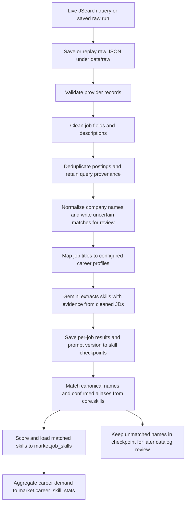
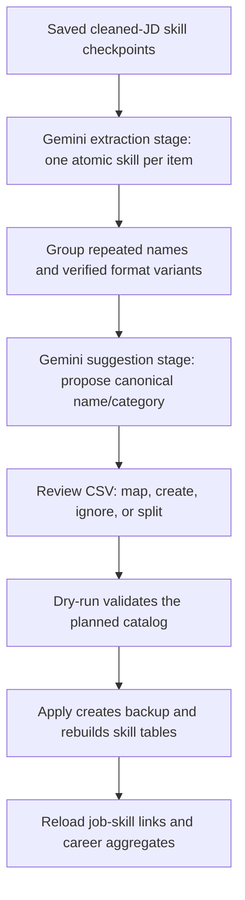

# Repository architecture

This repository is organized as a data-processing sub-repository for Glow-Job.
Each domain owns its processing rules and database queries; only reusable
adapters and cross-domain vocabulary live under `src/shared`.

## Package layout

```text
src/
├── market/                       # Implemented job-market data pipeline
│   ├── ingestion/                # JSearch, raw responses, and input validation
│   ├── cleaning/                 # Job record and description cleaning
│   ├── normalization/            # Deduplication, company, and career mapping
│   ├── skill_extraction/         # JD skill extraction, review, and job-skill loading
│   ├── aggregation/              # Career-level skill-demand statistics
│   ├── config/                   # Market pipeline settings and logging
│   ├── main.py                   # Market extraction/replay CLI implementation
│   └── pipeline.py               # Full market workflow orchestration
├── resume/                       # Planned CV/resume processing domain
│   ├── parsing/
│   ├── extraction/
│   ├── normalization/
│   └── schemas/
├── documents/                    # Planned learning-document/RAG preparation domain
│   ├── ingestion/
│   ├── parsing/
│   ├── chunking/
│   ├── extraction/
│   ├── embeddings/
│   └── schemas/
└── shared/                       # Code reused by multiple domains
    ├── skill_normalization/
    ├── llm/
    ├── db/
    ├── utils/
    └── schemas/
```

`market` is the only domain with an end-to-end implementation today. The
`resume` and `documents` packages are scaffolds: their package boundaries and
contracts are documented, but parsing, extraction, embeddings, and vector-store
behavior have not been implemented.

## Script and test layout

CLI implementations and tests follow the same domain boundaries:

```text
scripts/
├── market/       # Job-market ingestion, skill review, and aggregation commands
├── database/     # Cross-domain migrations and schema operations
├── resume/       # Reserved for resume commands
└── documents/    # Reserved for learning-document commands

tests/
├── market/       # Market pipeline behavior and fixtures
├── shared/       # Reusable adapters and normalization
├── resume/       # Reserved for resume behavior
└── documents/    # Reserved for document-processing behavior
```

Run commands with their namespaced module paths, such as
`python -m scripts.market.run_pipeline` or
`python -m scripts.database.migrate`.

## Market data flow



The regular pipeline can start from live JSearch responses or replay a saved
run. Replay does not call JSearch. Skill checkpoints let it resume completed
jobs without repeating Gemini requests for the current extraction prompt.
Failed extraction stops the orchestrated run before database loading; successful
checkpoint entries remain available for a later replay.

## Skill catalog maintenance flow

Catalog maintenance is separate from normal posting ingestion. It rebuilds
canonical names and aliases from saved, cleaned job descriptions:



There are two kinds of Gemini work in a full clean rebuild: extracting skills
from postings and suggesting canonical names for candidate groups. Each stage
can make multiple API requests; this does not mean the workflow always makes
exactly two API calls. A normal market run uses the extraction stage and matches
its results against the catalog already in PostgreSQL; it does not run the
catalog-suggestion stage.

The candidate review CSV is the decision checkpoint. `ready_for_approval`
proposals can be applied automatically when they pass the configured checks;
`manual_review` and `needs_llm_suggestion` candidates require a decision. A
`map_existing` decision records the observed spelling as an alias of the chosen
canonical skill. A `split` decision applies components to copied checkpoint
data; it does not rewrite the original extraction checkpoint.

At runtime, skill matching uses canonical and alias lookups after Unicode
compatibility normalization, case folding, and whitespace cleanup. A verified
acronym suffix can map to its base canonical name; a leading `and` or `or` is
removed only when the remaining complete label exactly matches the catalog.
Comma- or semicolon-separated labels are split only when the evidence supports
every component. Fuzzy similarity is for review suggestions, not an automatic
database match. Unknown names remain unmatched and are not inserted into
`core.skills` by the job loader.

Applying a clean rebuild backs up and replaces only:

- `core.skills`
- `core.skill_aliases`
- `core.skill_candidate_reviews`
- `market.job_skills`
- `market.career_skill_stats`

Skill identities restart at 1. Job postings, careers, companies, and raw JSearch
data remain in place. The exact prepare, review, dry-run, and apply commands are
in the [skill-candidate review guide](../market/skill-candidate-review-guide.md).

## Shared package rules

- `shared/skill_normalization` owns canonical skill-name keys and catalog
  matching that can be used by job, resume, and document workflows.
- `shared/llm` owns provider clients, retry behavior, and API configuration;
  prompt and domain-specific output validation stay in the owning domain.
- `shared/db` owns generic connection setup. Market-specific queries and
  repositories stay in `market`.
- `shared/utils` contains domain-neutral helpers. A helper that depends on job
  posting fields belongs in `market` instead.
- `shared/schemas` is for contracts reused across domains; domain-only schemas
  stay under their domain package.

## Sub-repository integration

The host `glow-job` repository should compose these packages at its application
boundary. Keep user-facing application flows, authorization, and product
services in the host repository. Keep market collection, resume data
processing, and learning-document preparation in their respective packages
here. Cross-domain records should use shared schemas and the shared canonical
skill vocabulary rather than importing another domain's internal modules.
