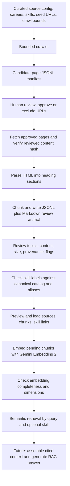

# Document Extraction Flow

## 1. Purpose and boundary

This guide describes how a curated learning document becomes searchable knowledge in PostgreSQL. It follows the document workflow from source configuration through retrieval and explains where review is required.

The document pipeline prepares and retrieves evidence. It does not, by itself, decide skill prerequisites, produce a complete curriculum, or generate a personalized roadmap. A future RAG layer will combine retrieved evidence with the user's profile, target career, job-market skill gaps, and verified dependency data.

## 2. Current status

The reviewed demo corpus has completed source discovery, page review, approved-HTML parsing, chunking, canonical-skill checks, database loading, and Gemini Embedding 2 embedding in PostgreSQL/pgvector. A command-line vector-search prototype is available. The corpus can be expanded by repeating the same review and ingestion flow for additional or updated documents.

Systematic retrieval evaluation, relevance thresholds or reranking, context assembly, LLM answer generation with citations, evidence-backed dependency proposals and review, learning modules, and roadmap-agent integration are follow-up work. See the [RAG specification](skill-knowledge-rag-spec.md) for requirements and phases.

## 3. End-to-end flow



Run the commands below from the `data-pipeline` directory. Paths are relative to that directory unless an absolute path is supplied.

## 4. Stage-by-stage flow

### 4.1 Curate a source configuration

Add a source to `config/document_sources.yaml` with a stable `id`, publisher when known, career tracks, canonical skill labels, seed URLs, and crawl limits. Seeds should belong to one coherent host/path policy. The crawler follows only permitted boundaries and returns candidates for review; configuring a URL does not approve every discovered page.

The page title and headings are read from the site. The YAML supplies initial scope and crawl controls; it is not intended to duplicate every page's metadata.

### 4.2 Discover candidate pages

Run a bounded crawl for one configured source:

```powershell
python -m scripts.documents.crawl --source-id airflow-official-tutorials
```

The command writes a timestamped JSONL manifest under `data/raw/documents/crawl-manifests/`. Each row records the page URL, canonical URL when available, title, detected headings, source/skill labels, depth, fetch status, review status, and content hash when available. New candidates start as `pending`; discovery does not load them into the knowledge tables.

Check that the manifest contains relevant pages, stays within the configured crawl bounds, and records failures or unsupported content types clearly.

### 4.3 Review candidate URLs

Approve or exclude URLs explicitly and write a reviewed copy of the manifest:

```powershell
python -m scripts.documents.review_manifest `
  --manifest "data/raw/documents/crawl-manifests/<crawl>.jsonl" `
  --output "data/raw/documents/reviewed-manifests/<review>.jsonl" `
  --approve-url "<approved-url>" `
  --exclude-url "<excluded-url>"
```

Replace each quoted placeholder with a filename or URL from the candidate manifest before running the command. Repeat `--approve-url` or `--exclude-url` when reviewing multiple pages.

Review whether each page is relevant to the intended skill, comes from a suitable source, and is appropriate to retain. The review script rejects URLs that are not present in the input manifest. Keep the original candidate manifest so the discovery result remains auditable.

### 4.4 Parse approved HTML

Parse only approved pages for the selected source:

```powershell
python -m scripts.documents.parse_approved `
  --source-id airflow-official-tutorials `
  --reviewed-manifest "data/raw/documents/reviewed-manifests/<review>.jsonl"
```

The parser fetches each approved URL again, checks that its content hash has not changed since review, removes common navigation/boilerplate, and groups readable text under heading paths. It writes a timestamped parsed-page JSONL artifact under `data/processed/documents/parsed-pages/by-source/`. Parsing remains reviewable file output; it does not write database rows. The current parser supports HTML; other file formats are future work.

If the page changed after review, the command stops for that page. Recrawl and review the updated content before parsing it.

### 4.5 Create and inspect chunks

Create chunks from approved parsed pages:

```powershell
python -m scripts.documents.chunk_approved `
  --input "data/processed/documents/parsed-pages/by-source/<parsed-pages>.jsonl" `
  --max-words 400
```

The chunker uses heading sections first and splits oversized prose at paragraph/sentence boundaries near the configured word target. It keeps fenced code blocks intact where possible and flags oversized code blocks. It writes JSONL for later loading and Markdown for human review. Combined input under `parsed-pages/combined/` writes to `chunks/combined/`; individual sources write to `chunks/by-source/` by default.

Keep each source's parsed JSONL in `parsed-pages/by-source/`. For a cross-source or cross-career corpus, combine the approved parsed records into a separate JSONL under `parsed-pages/combined/`, then run the chunker on that combined file. This preserves the per-source artifacts while giving the loader one reviewed corpus to apply.

Review the Markdown output for:

- One coherent subject per chunk and a useful heading/topic.
- Enough surrounding explanation for code, tables, and lists to make sense.
- Correct source URL, title, skill labels, career labels, and chunk index.
- Chunk sizes and any review flags.

Chunking does not decide prerequisite relationships. A page heading or the order of sections is not proof that one skill must precede another.

### 4.6 Validate skill labels

Check labels against `core.skills` and `core.skill_aliases` before loading:

```powershell
python -m scripts.documents.check_chunk_skills
```

The report identifies exact matches, aliases, and missing or ambiguous labels. Resolve unmatched labels in the source/chunk data or skill catalog before applying the load. A chunk may legitimately map to more than one canonical skill.

### 4.7 Preview and load into PostgreSQL

Preview the reviewed combined chunks first:

```powershell
python -m scripts.documents.load_chunks
```

The preview checks the input and resolves skill names without modifying the database. After the preview is correct and migrations `010`–`013` are applied, persist the records:

```powershell
python -m scripts.documents.load_chunks --apply
```

The loader writes source metadata to `knowledge.knowledge_sources`, chunk text/topic/metadata to `knowledge.knowledge_chunks`, and canonical skill links to `knowledge.knowledge_chunk_skills`. It does not create embeddings. If chunk content changes on a later load, its prior vector is cleared so it can be regenerated.

### 4.8 Generate embeddings

Preview chunks that are still pending embeddings:

```powershell
python -m scripts.documents.embed_chunks
```

Generate and store vectors with:

```powershell
python -m scripts.documents.embed_chunks --apply
```

The demo uses Gemini Embedding 2 at 768 dimensions. Each document embedding uses the title and chunk text; the script paces requests using a token estimate and commits completed batches so a later run can resume. New documents with the same model and dimension need embeddings only for new or changed chunks. If the embedding model or dimensions change, vectors being searched together must be made compatible.

### 4.9 Check and retrieve

Check vector completeness, model, and dimensions:

```powershell
python -m scripts.documents.check_embeddings
```

Run a semantic search over the embedded chunks:

```powershell
python -m scripts.documents.search_chunks `
  --query "ใน Airflow จะส่งผลลัพธ์จาก task หนึ่งไปอีก task อย่างไร" `
  --skill "Apache Airflow" `
  --limit 5
```

The query is embedded in a search-specific format and ranked against stored vectors by cosine similarity. `--skill` accepts one canonical skill or alias and filters to chunks linked to that skill; omitting it searches across all skills. `--limit` defaults to 5 and accepts up to 50. The command displays excerpts of up to 700 characters per result, so a cut-off excerpt does not mean the database chunk was truncated. Similarity is a ranking score, not a confidence percentage. The current prototype has no minimum score threshold, reranker, duplicate suppression, context-token budget, or LLM answer generation.

For targeted questions, use the known target skill filter. For broad goals or prerequisite discovery, search broadly or perform a separate retrieval for verified prerequisite skills; do not infer a dependency from a similar result alone. Review whether the top results actually support the query and whether the source citation points to the right page.

## 5. What the indexed corpus enables

Embeddings make relevant document chunks retrievable; the embedding vectors do not themselves produce a checklist, answer, or dependency graph. A future RAG answer flow should:

1. Build a query from the user's intent, skill gap, and target skill when known.
2. Retrieve and select relevant chunks, optionally applying canonical-skill filters.
3. Pass a bounded set of chunk text and provenance (title, URL, topic, skill, score) to a language model.
4. Ask the model to answer only from this evidence, cite the supporting sources, and report when the corpus does not establish an answer.

The same documents can support a learning-topic checklist when the model summarizes retrieved chunks with citations. Checklist coverage is limited to the material in the indexed sources; it is not automatically a complete curriculum.

## 6. Skill dependency proposals are a separate step

When a document explicitly says that one skill is required before another, a future extraction job may propose a dependency with the exact evidence text, source URL/ID, and resolved canonical skill IDs. Store proposals as unverified until they are reviewed; only verified relationships should determine required learning order. If the document does not state a relationship, leave it unknown. Do not infer prerequisites from job-market co-occurrence, topic order, or vector similarity.

The current document/search workflow does not automatically extract or persist dependency proposals. Documents can be added incrementally, and a lack of dependency evidence for a skill is a corpus coverage gap rather than a failed embedding.

## 7. Outputs and storage locations

| Artifact | Default location or table | Purpose |
|---|---|---|
| Source configuration | `config/document_sources.yaml` | Curated seed URLs, scope, career, skills, and crawl bounds. |
| Candidate manifest | `data/raw/documents/crawl-manifests/` | Discovered URLs, crawl status, and review decisions to be made. |
| Reviewed manifest | `data/raw/documents/reviewed-manifests/` | Explicitly approved/excluded candidate URLs. |
| Parsed pages | `data/processed/documents/parsed-pages/by-source/` or `combined/` | Cleaned text grouped by heading path for inspection. |
| Chunk artifacts | `data/processed/documents/chunks/by-source/` or `combined/` | Chunk JSONL for database loading and Markdown for review. |
| Sources | `knowledge.knowledge_sources` | Source metadata and canonical URL. |
| Chunks and vectors | `knowledge.knowledge_chunks` | Searchable text, topic, metadata, model name, and embedding. |
| Chunk-to-skill links | `knowledge.knowledge_chunk_skills` | Canonical many-to-many mapping from chunks to skills. |

The database stores the searchable source metadata and chunks; the crawl and review manifests and parsed/chunk artifacts remain files. The current parser refetches approved HTML and does not archive a full copy of every original web page in PostgreSQL.

## 8. Related documents

- [Skill knowledge and RAG specification](skill-knowledge-rag-spec.md) — requirements, schema constraints, acceptance criteria, and implementation phases.
- [Learning graph flow](learning-graph-flow.md) — how evidence-backed document knowledge can later support reviewed skill dependencies.
- [Document domain README](../../src/documents/README.md) — package overview and quick commands.
