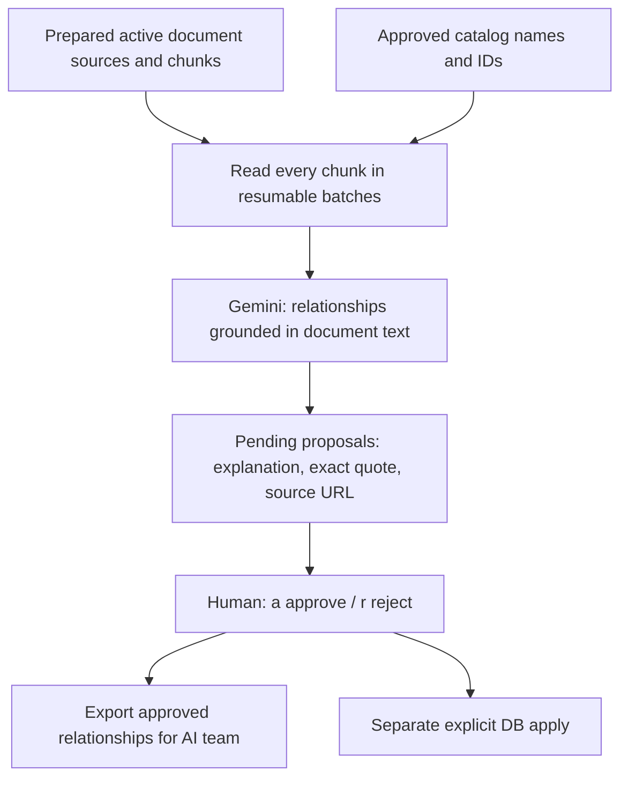

# Skill dependencies from the prepared documents

## Current scope

Use only the user's prepared active document corpus: currently 48 sources, 525
stored chunks, and 24 mapped canonical target skills. The database catalog is a
name/ID lookup; it is not a list of 539 targets to generate from general knowledge.
No web discovery, new documents, Resume content or user records are used.

The current queue is `data/processed/skill_dependencies/prepared-documents-v1.json`
with a readable `.md` beside it. The `.evidence.json` freezes the actual prepared
corpus read by the model. The earlier `catalog-bootstrap-v1` (491 relationships)
was outside the clarified scope and must not be used for this review or handoff.
Older 18-chunk batches are references, not extra queues to review.

Development snapshot, 2026-10-18: the 23-row queue is fully reviewed (18 approved,
5 rejected). The 18 approved rows are now applied to knowledge.skill_dependencies
and readable through verified lookup. Post-apply dry-run reports 0 new / 18 already
verified. The local `prepared-documents-v1.db-receipt.json` records that verification.
Runtime roles are 1 global ordering, 14 scoped context, and 3 informational; approval
does not turn every relationship into a universally required prerequisite.



Every proposal cites a real source/chunk, an exact quote and a content hash. Both
endpoint concepts must be grounded in the supplied document. A navigation item,
book recommendation or source title alone is not evidence of a dependency.

- `basis=explicit`: the text directly supports the relationship.
- `basis=inferred`: learning advice derived from the passage's substantive
  explanation. This can be recommended_before or related, never a hard prerequisite.
  The Thai explanation must distinguish the document statement from the inference.

The model supplies relationship type, scope and any condition before review.
You only accept or reject the proposed claim. Reading all stored chunks does not
prove that the prerequisite graph is complete or that every target has a dependency.

## 1. Generate or resume the document queue

From the **glow-job root in CMD**, using the existing Docker runtime:

```cmd
docker compose run --rm --no-deps -T -e PYTHONDONTWRITEBYTECODE=1 -e PYTHONPATH=/workspace/data-pipeline ^
  -v "%CD%:/workspace:ro" ^
  -v "%CD%/data-pipeline/data/processed/skill_dependencies:/output" ^
  -w /workspace/data-pipeline backend ^
  python -u -m scripts.documents.skill_dependencies corpus --output /output/prepared-documents-v1.json
```

This calls the shared Gemini text client with the prepared public documents and
catalog lookup, saves raw responses, validates IDs/quotes/scopes, and checkpoints
every completed batch. Default limits are 24 full chunks and 40,000 content
characters per request. No content is truncated and there is no keyword-only
filter: every chunk in the frozen prepared corpus is considered. The full catalog
is available only to resolve a concept actually discussed in these documents.
Proposals are validated individually: one malformed quote does not discard other
valid proposals in the batch. Failed items are retried and logged locally; unresolved
invalid items stay outside the human-review queue. Validation-failure counts describe
attempts, not distinct dependencies. Missing explicit/inferred classification is
treated conservatively as inferred advice and cannot become a hard requirement.

Rerun the same command to resume unread chunks. Existing reviewed proposals remain
in the checkpoint. Use a new output filename to process a changed corpus. The
command does not crawl, create skills, approve suggestions or write DB records.
Targets are approved canonical IDs mapped to the prepared chunks; a prerequisite
may have no dedicated source of its own, but must be discussed by the cited text.

With a local data-pipeline Python environment the equivalent command is:

```cmd
python -m scripts.documents.skill_dependencies corpus --output data/processed/skill_dependencies/prepared-documents-v1.json
```

## 2. Review: only approve or reject

From the glow-job root:

```cmd
scripts\rag\review_dependencies.cmd
```

The launcher opens `prepared-documents-v1.json`, not the catalog-only batch.
Each row shows the skill direction, type, Thai explanation, exact quote, source
URL, basis and any proposed condition. No reviewer reason is requested.

| Input | Result |
|---|---|
| `a` | Approve the displayed relationship and condition; save immediately |
| `r` | Reject immediately; no reason required |
| Enter | Leave it pending |
| `q` | Quit with previously saved decisions retained |

Rerunning skips completed rows. To correct a decision:

```cmd
scripts\rag\review_dependencies.cmd --row 12
```

`--include-reviewed` reopens all rows. Reviewer label/time and proposal fingerprint
are recorded automatically. Audit notes explicitly state when no reviewer reason
was supplied; they do not invent a human rationale. Old manifests remain readable.
A changed proposal must receive a new review rather than inheriting an old decision.

For prerequisite/recommended_before, A -> B means A prepares for B. Related imposes
no order. Scoped claims apply only within the displayed document/learner condition;
accepting them does not establish that every learner needs that preparation.
Legacy unknown scopes or missing conditions cannot be approved without correction;
the new corpus generator resolves these fields before putting items in the queue.

## 3. Counts and reports

Using local Python from data-pipeline:

```cmd
python -m scripts.documents.skill_dependencies status --manifest data/processed/skill_dependencies/prepared-documents-v1.json --report data/processed/skill_dependencies/prepared-documents-v1.md
```

Docker users can reuse the generation command above with `status --manifest
/output/prepared-documents-v1.json` instead of `corpus --output ...`.
`chunks_read`/`chunks_remaining` describe processed stored text. `target_skills`
counts document-mapped targets. `pending`/`approved`/`rejected` count relationship
rows. Multiple sources or materially different conditions may support the same
skill pair; exact duplicate claims in the same scope are suppressed.
Approval counts are local decisions, not DB application counts.

## 4. Export approved relationships for the AI team

From the glow-job root in CMD:

```cmd
docker compose run --rm --no-deps -T -e PYTHONDONTWRITEBYTECODE=1 -e PYTHONPATH=/workspace/data-pipeline ^
  -v "%CD%:/workspace:ro" ^
  -v "%CD%/data-pipeline/data/processed/skill_dependencies:/output" ^
  -w /workspace/data-pipeline backend ^
  python -m scripts.documents.skill_dependencies export --manifest /output/prepared-documents-v1.json --output /output/dependencies-ai-handoff.json
```

The JSON includes only approved edges, canonical names/IDs, Thai explanations,
explicit/inferred basis, source URL/IDs, exact quote/hash, scope/condition and human
review metadata. Pending and rejected proposals are excluded. General ordering
cycles block export; related and scoped context do not impose global ordering.
The export refers to the reviewed source snapshot, not a fresh live DB verification.
Consumers must preserve scope and distinguish recommendations from hard prerequisites.
No user proficiency or prerequisite satisfaction is inferred from these edges.
Generated artifacts are Git-ignored and must be shared explicitly with teammates;
canonical IDs must match the receiving database.

## 5. Optional explicit DB apply

From data-pipeline with local dependencies/environment:

```cmd
python -m scripts.documents.skill_dependencies apply --manifest data/processed/skill_dependencies/prepared-documents-v1.json
```

This is a read-only dry-run. Migrations 014/015 are required for a real write:

```cmd
python -m scripts.database.migrate
python -m scripts.documents.skill_dependencies apply --manifest data/processed/skill_dependencies/prepared-documents-v1.json --apply
```

Only human-approved rows are applied. Live canonical IDs/names, active source,
chunk/source linkage, content hash, exact quote, target mapping and general ordering
cycles are rechecked. The batch is atomic and identical verified rows are a no-op.
`is_verified` describes the reviewed relationship in its stored scope; it does not
make an inferred recommendation into an explicit documentary requirement.
The local manifest/export retains explicit/inferred basis; the current dependency
DB schema does not have a separate basis column (the proposal rationale is not a
substitute for such a column). Preserve the handoff artifact for that distinction.
Pending/rejected history stays local. The reviewer label is not authentication.

`list` reads only verified, active-source, scope-complete dependencies and rechecks
live quote/hash. Scoped edges are context only. Unknown coverage is never presented
as proof that no prerequisites exist.

## Files

- `src/documents/extraction/dependency_corpus.py`: whole prepared-corpus batches,
  progress/resume and approved-only document handoff export.
- `src/documents/extraction/skill_dependencies.py`: evidence validation, source
  matching, proposal inference boundaries, DB apply/lookup and cycle checks.
- `src/documents/schemas/skill_dependency.py`: proposals, explicit/inferred basis,
  review fingerprints and corpus progress.
- `scripts/documents/skill_dependencies.py`: corpus/propose/review/status/export/apply/list.
- Root `scripts/rag/review_dependencies.cmd`: CMD review shortcut.

No Roadmap Agent, app UI, scoring policy or user persistence is implemented here.
