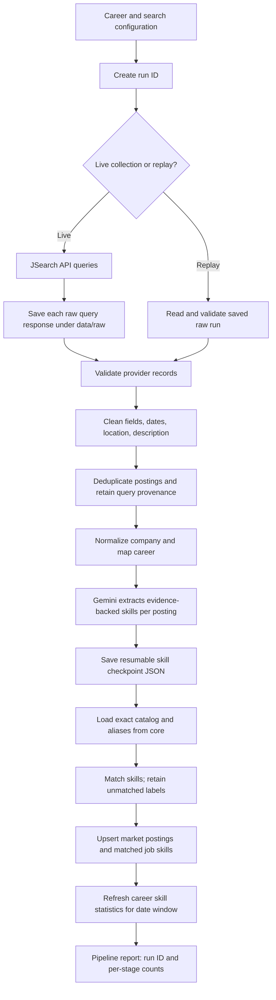

# Market Data Pipeline: End-to-End Flow

This document describes the implemented job-market pipeline, from JSearch
requests through career-level skill-demand statistics. The main orchestration
entry point is `src.market.pipeline.run_pipeline`; individual stages live under
`src.market/`.

## At a glance

## Detailed stages

### 1. Configure and start a run

`config/careers.yaml` supplies career profiles and their JSearch queries;
`config/pipeline.yaml` supplies provider/search and validation settings. A live
run receives a UTC run ID. A replay run reuses a run ID whose raw responses
already exist under `data/raw/`.

Entrypoints:

- `python -m scripts.market.main` runs extraction/normalization and can stop
  after writing the skill checkpoint.
- `python -m scripts.market.run_pipeline --live ...` runs all stages through
  database loading and aggregation.
- `python -m scripts.market.run_pipeline --replay-run-id <id> ...` resumes the
  downstream stages from a saved raw run. Completed skill checkpoint entries
  are reused; failed/missing entries can be retried under the same run ID.

### 2. Collect and preserve source responses

For a live run, `src/market/ingestion/extract_jobs.py` iterates configured
career/query pairs and calls JSearch through `extract_single_query.py`. It
stores each complete provider response, query, career, query number, run ID,
and collection timestamp as JSON under
`data/raw/YYYY/MM/DD/<run_id>/`. These files are source snapshots and make
replay possible without another JSearch request. Replay checks that all
expected query-number files are present before processing continues.

### 3. Validate, clean, and deduplicate

`job_validator.py` rejects records missing required or valid fields and
reports the reasons. `job_cleaner.py` normalizes provider values such as
description whitespace, dates, and location while retaining valid postings
whose publication date is unknown. `deduplicator.py` collapses repeated
postings while preserving their distinct search matches and application links.

The raw responses remain unchanged. Rejected/cleaned/duplicate counts are
reported by the run; they are not silently removed from the source files.

### 4. Normalize company and career information

`company_normalizer.py` resolves confirmed company names/aliases and emits
possible matches to a run-specific review CSV. Fuzzy company candidates are
not merged automatically. `career_mapper.py` maps each title to the configured
career profile and records whether the mapping is mapped, ambiguous, or
unmapped. The original title is retained. Only a valid mapped career can be
loaded as a market posting.

### 5. Extract skills and checkpoint the result

`skill_extraction/extractor.py` sends each eligible cleaned job description to
Gemini and asks for atomic skill names, requirement/proficiency details, and
supporting evidence. The response is validated and scored downstream; the
model's raw skill wording is retained. A JSON checkpoint is written after each
job to `data/processed/skill_extraction/<run_id>.json`, so interrupted runs can
resume without repeating already completed requests.

This normal extraction path does **not** create new catalog skills. Catalog
rebuild is a separate prepare/review/`--apply` workflow documented in the
[skill candidate review guide](skill-candidate-review-guide.md).

### 6. Match against the shared skill catalog

Before loading, `shared.skill_normalization` reads `core.skills` and
`core.skill_aliases`. It uses deterministic exact canonical/alias matching,
case/spacing normalization, and a verified acronym form. A comma/semicolon
composite is split only when every component is supported by the evidence;
otherwise it remains unmatched. Similarity alone does not silently choose a
catalog skill.

The checkpoint distinguishes:

- `skills`: raw extracted labels and their evidence;
- `normalized_skills`: labels matched to catalog skill IDs;
- `unmatched_skills`: labels that need catalog/review handling.

Unmatched labels remain in the checkpoint and are not inserted into `core` by
the routine job-skill loader.

### 7. Load relational market data

When every requested job extraction has completed, `job_skill_loader.py`
opens a database transaction. It upserts eligible postings in
`market.job_postings`, records query provenance in
`market.job_search_matches`, and inserts/updates only catalog-matched rows in
`market.job_skills`. It also calculates evidence/confidence and importance
weights, removes stale job-skill links, and marks extraction complete even if
a posting has no matched skills. Failed extractions, missing provider IDs,
and unmapped careers remain in checkpoint output and are skipped for loading.

### 8. Aggregate job-market demand

`career_skill_aggregator.py` selects completed postings with descriptions in
the requested inclusive UTC date window. The window can use provider
`posted_at` or pipeline `first_seen_at`. It aggregates demand by career profile
and skill (counts, percentages, requirement mix, weighted score, and supported
target level), replaces the matching statistics window, then writes
`market.career_skill_stats`. The returned result includes processed jobs,
loaded posting/skill counts, and aggregation counts.

## What marks completion?

For the **full** `run_pipeline`, completion means all requested skill
extractions are complete, eligible postings and matched skill links have been
upserted, and the requested aggregate window has been refreshed. A failed skill
extraction stops the run before database loading and aggregation; reuse the run
ID to resume. A standalone `scripts.market.main` invocation may only create raw
or checkpoint artifacts and is not equivalent to a full database pipeline.

## Main implementation map

| Stage | Main implementation |
|---|---|
| Orchestration | `src/market/pipeline.py`, `src/market/main.py` |
| Search and raw replay | `src/market/ingestion/` |
| Validation and cleaning | `src/market/ingestion/validation/`, `src/market/cleaning/` |
| Company/career normalization | `src/market/normalization/` |
| Skill extraction and checkpoints | `src/market/skill_extraction/extractor.py`, `skill_result_storage.py` |
| Catalog matching | `src/shared/skill_normalization/` |
| Database loading | `src/market/skill_extraction/job_skill_loader.py` |
| Aggregation | `src/market/aggregation/` |
