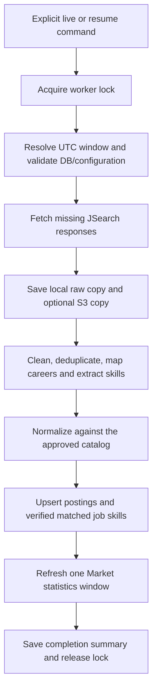

# Scheduled Market pipeline on EC2

## Scope and implementation plan

Branch: `feature/ec2-market-pipeline` in the host and pipeline repositories.
This stage prepares a complete command for a single EC2 worker. Installing cron,
changing live IAM policies, deploying to EC2, and running paid APIs are later steps.

The command must perform this sequence:



Implementation requirements:

1. Reuse the existing Market stages rather than create parallel extraction logic.
2. Keep existing manual CLI commands compatible; add a scheduled entry point.
3. Save a local raw copy even when S3 is enabled. Resume can restore an individual
   saved response by looking up its exact S3 key prefix and reading the object.
   Back up the journal, each skill checkpoint update, the run-specific company
   candidate report and completion summary under `market/pipeline-runs/<run_id>/`.
4. Freeze the run configuration/window in a local journal. Resume keeps the same
   run ID, raw responses and skill checkpoint; it can call APIs for missing work.
5. Stop before database loading if skill extraction is incomplete. Loading and
   aggregation remain separate transactions; retry can repeat committed stages.
6. Treat an empty processed run as a successful no-job outcome and still refresh
   the requested statistics window from existing eligible DB postings.
7. Prevent overlapping runs on one worker with an OS file lock; keep per-attempt
   logs, stage state, and a JSON summary under ignored `data/processed/`.
8. Provide an offline dry-run. Do not schedule execution or call APIs during setup.

## Delivery boundary

The runner is implemented in `scripts.market.run_scheduled_pipeline`, backed by
`src.market.scheduled_pipeline` and the existing Market stage functions.
This guide is the reference for this stage. Multi-worker coordination, external
alerts, a cron installation, automatic retries, and disaster recovery of skill
checkpoints from a lost EC2 volume are not provided by the first runner.

## Prerequisites

- Install the pipeline requirements in the EC2 Python environment. The existing
  dependencies include boto3 and the shared Gemini SDK.
- Apply the combined DB migrations separately, seed the configured active career
  profiles, and provide the reviewed approved skill catalog. This command never
  migrates a DB, seeds reference data, or creates catalog skills automatically.
- Configure `data-pipeline/.env` or process environment:

  ```dotenv
  DB_HOST=your-rds-endpoint
  DB_PORT=5432
  DB_NAME=glowjob
  DB_USER=your_application_role
  DB_PASSWORD=your_database_password
  JSEARCH_SECRET_ID=your-jsearch-secret-name
  GEMINI_API_KEY=your-gemini-key
  RAW_S3_BUCKET=glow-job-raw-data
  RAW_S3_PREFIX=raw/jsearch
  AWS_DEFAULT_REGION=us-east-1
  ```

  Use the real region/endpoint. `JSEARCH_API_KEY` is an alternative to
  `JSEARCH_SECRET_ID`. Database routing and config are checked before API work;
  secret values/passwords are not written into the run journal.
- Attach S3 permissions to the EC2 instance role. The host provides
  `infra/aws/ec2-market-pipeline-s3-policy.json`: PutObject/GetObject on the raw
  and run-artifact prefixes with ListBucket limited by `s3:prefix`. The old write-only policy is enough
  for uploading but not for recovering missing local responses. If the bucket or
  prefix differs, update both policy resources/conditions. KMS-encrypted buckets
  and Secrets Manager secrets can require their respective additional permissions.
- Keep `data` on a durable EC2 volume for normal operation. A missing run journal
  and skill checkpoint can be restored from S3 when resuming the same run ID.
  The restored journal validates the original configuration, DB route, query
  order and `--data-dir` path. Use the same path on a replacement worker.

The Market skill extractor still uses the shared Gemini text model. This command
does not generate document embeddings or switch embedding models.

## Commands

Run from `data-pipeline/` on a machine with the dependencies installed.

### Offline preview

```bash
python -m scripts.market.run_scheduled_pipeline --live --dry-run
```

This only reads local configuration and prints the plan. It does not reserve a run
ID, acquire a lock, create logs, call AWS/JSearch/Gemini, or connect to the DB.
It cannot verify remote IAM, network access, quotas or credentials.

### Full new run

```bash
python -m scripts.market.run_scheduled_pipeline --live
```

Default raw storage is **S3 plus a local copy**; a missing `RAW_S3_BUCKET` is an
error rather than a fallback to local-only storage. Select local output explicitly:

```bash
python -m scripts.market.run_scheduled_pipeline --live --raw-storage local
```

The default statistics window is `validation.time_window_days` from
`config/pipeline.yaml` (currently 184 inclusive UTC days ending today).
The default date basis is `first_seen_at`. This is an aggregation window, not the
JSearch `date_posted` filter; that filter remains in `config/pipeline.yaml`.

### Weekly collection by posting date

The checked-in search configuration asks JSearch for results and applies a
seven-day publication-date rule before cleaning and DB loading:

```yaml
search:
  country: TH
  max_pages: 2
  date_posted: all
  posted_within_days: 7
```

`search.date_posted` is sent to JSearch on every query. The provider supports
`all`, `today`, `3days`, `week`, and `month`. In the 2026-10-24 live validation,
the provider returned zero jobs for two `week` queries, while an `all` response
included jobs labelled four and five days old. We therefore use `all` and validate
the parsed publication date against the response collection time locally.
Jobs with missing/invalid publication dates are excluded from recent-only runs;
the raw response is still retained for audit. This is a rolling 7-day limit,
not a fixed Monday-to-Sunday period. Cron controls when the command runs.

`search.posted_within_days` is separate from `validation.time_window_days: 184`,
which remains the general age-validation limit and the runner's default statistics
window. Weekly collection does not delete older RDS postings. `--window-days 7`
changes the statistics window only, not the recent posting rule.

Results remain limited by `max_pages` and provider coverage, so this method
does not guarantee every posting is returned. A missed weekly execution can also
leave a gap; a later live run does not backfill older results automatically.
After changing the configuration, start a new run; an older journal requires its
original configuration when resuming.

Use a different rolling window or explicit dates:

```bash
python -m scripts.market.run_scheduled_pipeline --live --window-days 30
python -m scripts.market.run_scheduled_pipeline --live --start-date 2026-10-01 --end-date 2026-10-24 --date-basis first_seen_at
```

Start/end dates are required together and cannot be combined with `--window-days`.
This runner processes the complete run; it has no `--skill-limit` option.
Use `--skill-request-interval 10` to set the wait between extraction requests.

### Resume an interrupted/failed run

```bash
python -m scripts.market.run_scheduled_pipeline --resume-run-id YOUR_RUN_ID
```

Use the actual timestamp `run_id` in the log/state file or S3 object path. Resume
restores a missing journal and checkpoint from S3 for runs created by this runner.
Do not pass replacement window/storage options; the
original window, data directory, query order/config, database route, extraction
model and prompt version must match. Existing completed raw queries are reused
from local disk or S3; only missing queries call JSearch. Restored/local responses
are uploaded again to the same S3 key, which can create another version in a
versioned bucket. Completed matching skill checkpoints skip their Gemini calls.

Resume can still incur API charges for missing/failed work. There is no exact-once
guarantee if an API request succeeds but the worker dies before saving its response.
Completed runs return their saved summary without redoing the pipeline. To fetch
new data, explicitly start another `--live` run.

Existing local files are not overwritten by S3 restore. Inspect a corrupt local
file explicitly before removing it. The company candidate CSV is archived, but
processing a resumed run can regenerate it. Manual catalog review decisions and
document manifests belong to separate workflows.

The older strict-local `scripts.market.run_pipeline --replay-run-id ...` remains
available. A run ID from an older command does not automatically have a new-runner
journal and cannot be passed to `--resume-run-id`.

## Output and failure behavior

```text
data/
├── raw/YYYY/MM/DD/<run_id>/*.json
└── processed/
    ├── skill_extraction/<run_id>.json
    ├── company_match_candidates/...
    └── pipeline_runs/
        ├── .worker.lock
        └── <run_id>/
            ├── state.json
            ├── attempt-001.log
            ├── attempt-002.log
            └── summary.json
```

For S3 runs, the bucket also contains `market/pipeline-runs/<run_id>/state.json`,
`skill_checkpoint.json`, `company_candidates.csv`, and `summary.json` when each
step has completed. A checkpoint is uploaded after every processed job. If an
upload fails, the run stops and leaves the local file available for retry.

- For timestamp runs, the raw folder date is the run's **UTC start day**, keeping
  requests that cross midnight together. Each response keeps its actual collection
  timestamp. Local and S3 keys use the same partition and query numbering.
- Raw JSON is saved locally before S3 upload. Upload failures stop the run and
  preserve the response, so a retry does not need another JSearch request.
- An unsuccessful/malformed JSearch response is saved as raw evidence but stops
  the run. Resume re-fetches that query; it is not counted as a successful empty
  result. A valid response containing an empty job list is allowed.
- Each attempt records its stage/status/timestamps and error class. Provider
  response bodies and secrets are not copied into the journal. Skill failures can
  also be inspected in the skill checkpoint. SIGKILL/power loss can leave status
  `running`; the OS lock is released by process exit and resume marks the old
  attempt interrupted.
- Stages are `preflight`, `ingestion_and_skill_extraction`, `database_load`, and
  `aggregation`. Successful outcomes are `completed` or `no_jobs`.
- `no_jobs` means no processed postings remain after validation/cleaning. It is
  not evidence that the external API had no results, or that no older DB postings
  exist. The requested statistics window is still refreshed from existing DB data.
- Job loading and aggregation commit separately. If aggregation fails after
  loading, loaded rows remain. Resume repeats upsert/loading and aggregation.
  Postings are upserted by provider ID; this does not promise every side effect or
  every paid API call is exactly once.
- Unmatched skills remain in the checkpoint and summary counts. They are not
  automatically added to `core.skills` or counted as matched `market.job_skills`.
- A completed run can legitimately load a posting with zero extracted/matched
  skills, for example a truncated JD with no exact skill evidence. The summary
  includes a warning when postings were loaded but no matched skills were stored.
  `completed` describes execution, not sufficient JD content or catalog coverage.
- Exit code `0`: completed/no-job/already-completed result; `1`: failed run or
  invalid configuration; `75`: another runner owns this worker's lock.
- The lock protects this runner on one worker using the same `--data-dir`.
  Older manual commands and multiple EC2 machines do not share that lock.

## EC2 shell entry point

```bash
bash /opt/glow-job/data-pipeline/scripts/market/run_scheduled_pipeline.sh --live --dry-run
bash /opt/glow-job/data-pipeline/scripts/market/run_scheduled_pipeline.sh --live
```

The wrapper uses the pipeline `.venv/bin/python`, falling back to `python3`.
Set `PYTHON_BIN` if necessary. It changes to the correct repository directory
and Python loads `.env`; it does not install packages, activate cron, or start Docker.

The older `run_scheduled_ingestion.sh` still invokes extraction-only
`scripts.market.main`. Select **run_scheduled_pipeline.sh** when configuring the
complete workflow. Disable the old EventBridge schedule before enabling cron for
the same job. Cron installation, timezone, external alerts/log rotation and an
EC2 live smoke run remain deployment steps after this code is reviewed.

## Validation record

See [scheduled-pipeline-validation.md](scheduled-pipeline-validation.md) for the
offline regression checks, bounded real API/S3 sample, isolated SQL load, source
quality observations and the remaining EC2/RDS deployment boundary.
