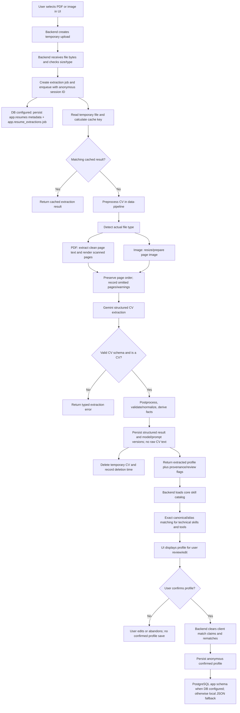

# Resume Data Pipeline: End-to-End Flow

This document follows a CV from upload to the confirmed profile. It separates
the reusable extractor in this repository from the HTTP orchestration and
profile storage owned by the host repository's Backend. The extractor package
itself does not connect to PostgreSQL.

## At a glance

## Detailed stages

### 1. Upload and create an extraction job (host Backend)

The UI uploads a supported PDF/JPEG/PNG/WebP using the Backend's upload
endpoints and sends its anonymous session ID when starting and polling a job.
The Backend validates declared MIME type, file size, actual file bytes, and
upload existence. It stores the upload temporarily, creates a job, and queues
it in the local in-process worker. When DB settings are present, it also creates
an anonymous user if needed and persists upload metadata and the extraction job
in `app.resumes` / `app.resume_extractions`. This is upload/job orchestration,
not functionality inside `data-pipeline/src/resume`.

### 2. Cache check and safe temporary-file handling (host Backend)

Before calling Gemini, the worker hashes the file and combines that hash with
the extraction provider/settings, versions, and preprocessing limits to form a
cache key. A cached result can be returned without another model request. On a
cache miss, the worker reads the temporary upload and calls the reusable
preprocessor. The uploaded file is deleted in the worker's `finally` path,
including when extraction fails.

### 3. Prepare model input (`data-pipeline/src/resume/parsing`)

`prepare_cv` detects the actual MIME type from file bytes rather than trusting
the filename. Unsupported formats are rejected. For PDFs, it examines pages
individually: readable text is extracted and scanned/poorly encoded pages are
rendered as images. For image uploads, the image is normalized/resized for the
model. Page order is preserved. Configured page caps can omit later scanned
pages; the result then carries `isPartial` and warnings listing the omitted
pages instead of pretending the CV was fully read.

### 4. Extract structured facts with Gemini

The Backend's configured extractor is `gemini` (or `mock` for development).
The resume Gemini adapter uses the shared Gemini client/model and sends either
text, page images, or both in original order. A resume-specific prompt asks
Gemini for a structured `CvExtraction`: personal information, education,
experience, projects, technical skills, tools, soft skills, languages, and
certifications/activities. It is a different extraction contract from the
market job-description skill prompt.

Gemini's JSON is validated against the resume Pydantic schema. The adapter can
request one schema repair after invalid structured output and retries certain
transient service errors. A non-CV document, timeout, unavailable model, empty
response, truncated response, or invalid final schema becomes a typed failure
on the extraction job.

### 5. Postprocess and produce a reviewable profile

`normalization/postprocess.py` builds the profile returned to the Backend. It
normalizes dates and safe formatting, deduplicates repeated labels, derives
summary facts where supported, attaches evidence/proficiency information, and
marks low-confidence or incomplete items for user review. Grounding is applied
when source text can be inspected; it is deliberately limited for scanned or
mixed documents where extracted text is incomplete. Raw CV wording is retained
for skill labels; the extractor does not create or rename canonical catalog
skills.

The response also includes provider/model, prompt/schema/processing versions,
duration, input kind, partial-document status, warnings, and a review count.
When DB is configured, the structured result and model/prompt/schema versions
are also retained in `app.resume_extractions.extracted_json`. Original CV bytes
and extracted raw document text are not retained. Without DB settings, the
development fallback keeps jobs in memory. The result is not yet a confirmed
saved profile.

### 6. Match extracted skills to Market's catalog (host Backend + shared code)

When the UI polls for a completed extraction, the Backend may load
`core.skills` and `core.skill_aliases` through its catalog adapter. It calls the
shared deterministic matcher for technical skills and tools only. Exact
canonical and alias matches get a `catalogMatch`; unmatched labels remain
visible and are flagged for review. Soft skills and spoken languages are not
matched to the technical catalog. This operation does not automatically create
catalog entries and does not discard the CV's observed skill name/evidence.

The catalog match shown during extraction is a helpful candidate annotation.
On save, the Backend clears any client-submitted catalog IDs and recomputes
matches against the current catalog so the browser cannot choose or forge a
skill ID.

### 7. User review and confirmed profile persistence (host Backend)

The UI lets the user correct the extracted profile and confirm it before
continuing to career goals/preferences. The profile save endpoint validates
the submitted profile, recalculates catalog matches, and calls the configured
profile repository. The current product flow is anonymous: a session ID is the
anonymous subject; login is not required.

When DB connection settings are configured, `DatabaseProfilesRepo` writes the
confirmed profile transactionally to the `app` schema (including the complete
profile JSON and supported normalized child rows). If DB settings are not
configured, the local development repository stores profiles in a JSON file.
Temporary upload bytes are deleted after extraction. The reusable resume
extractor is still database-free; database access is performed by the host
Backend adapters.

## End of this pipeline

Resume extraction is complete when a validated, postprocessed profile has been
returned and made available for user review. The **onboarding/profile workflow**
is complete only after the user confirms and the Backend persists the profile.
Career-gap analysis, roadmap generation, and learning-resource/document
retrieval are later product workflows; they are not performed by the CV
extractor described here.

## Main implementation map

| Stage | Main implementation |
|---|---|
| Upload, job queue, API polling | Host `backend/app/features/resume/router.py`, `pipeline.py`, `storage.py` |
| Extractor settings/provider selection | `src/resume/config.py`, `src/resume/extraction/providers/` |
| PDF/image preparation | `src/resume/parsing/preprocess.py` |
| Prompt and structured response | `src/resume/extraction/prompt.py`, `contracts.py`, `src/resume/schemas/cv_extraction.py` |
| Profile normalization | `src/resume/normalization/postprocess.py`, `derive.py` |
| Catalog matching | Host `backend/app/features/resume/catalog.py`; shared `src/shared/skill_normalization/` |
| Confirmed profile storage | Host `backend/app/features/resume/profiles.py`; local fallback in `storage.py` |
| Direct CLI/evaluation | `scripts/resume/extract.py`, `scripts/resume/evaluate_samples.py` |
